<div align="center">
  
</div>

# Subdomain Storm

[](https://python.org)
[](LICENSE)

Subdomain discovery for authorized testing. It combines certificate-transparency names from crt.sh with DNS lookups for a built-in or supplied list of labels. It uses only Python's standard library.

## Usage

```bash
# Passive certificate-transparency lookup and bounded DNS enumeration
python subdomain_storm.py example.com

# Passive only; do not perform DNS lookups
python subdomain_storm.py example.com --passive

# One DNS label per line; at most 20 concurrent DNS lookups
python subdomain_storm.py example.com --wordlist labels.txt --threads 20 -o subs.json
```

The tool asks for authorization before running. `--yes` skips that prompt and should only be used in authorized workflows. `--threads` accepts 1–50 (default 10); `--timeout` bounds the crt.sh request (default 15 seconds, maximum 60). A custom wordlist is limited to 10,000 unique labels. DNS lookup time is controlled by the local resolver and may vary by system.

JSON output includes the union of discovered names in `data.subdomains`, DNS-resolved names in `data.resolved_subdomains`, and per-source status in `data.sources`. Certificate-transparency records can be historical and do not imply that a name currently resolves. crt.sh failures are reported; DNS enumeration continues when enabled.

## Disclaimer

> Use only for domains you own or are explicitly authorized to assess. Active mode performs DNS lookups for the selected names; it does not scan ports or probe services.

## Author

**Omar Khalid** — [omareldemery.com](https://omareldemery.com) | [@amooryx](https://github.com/amooryx)
